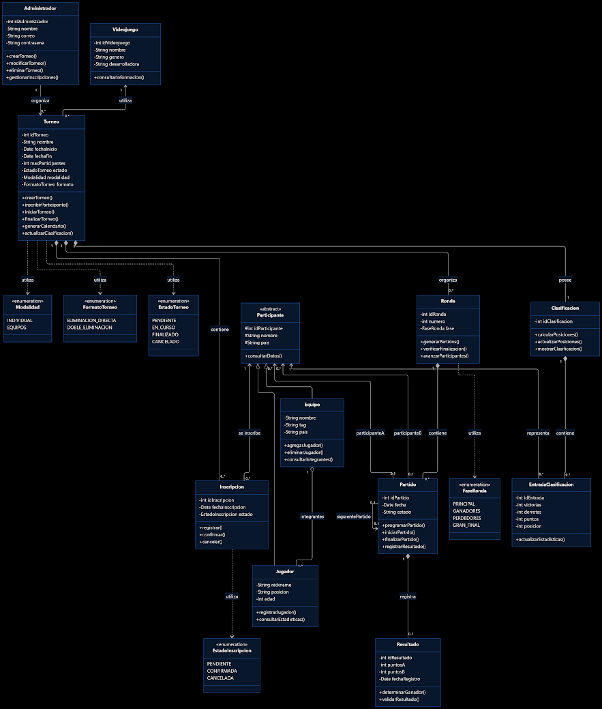
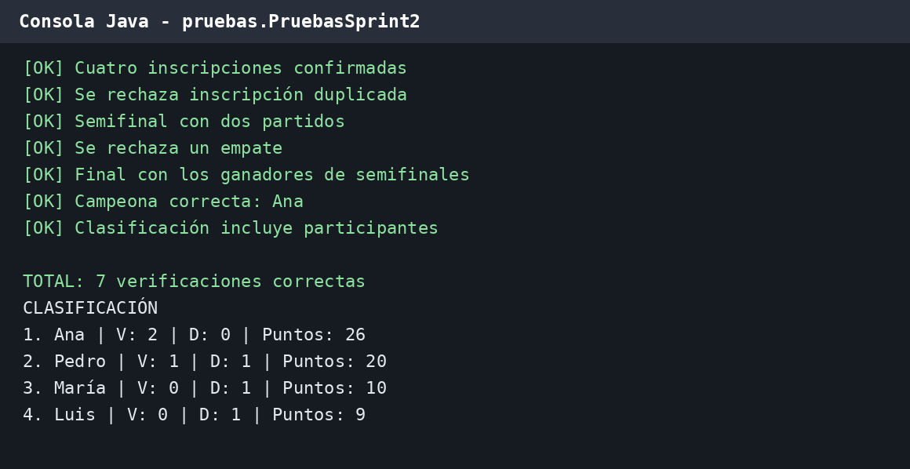
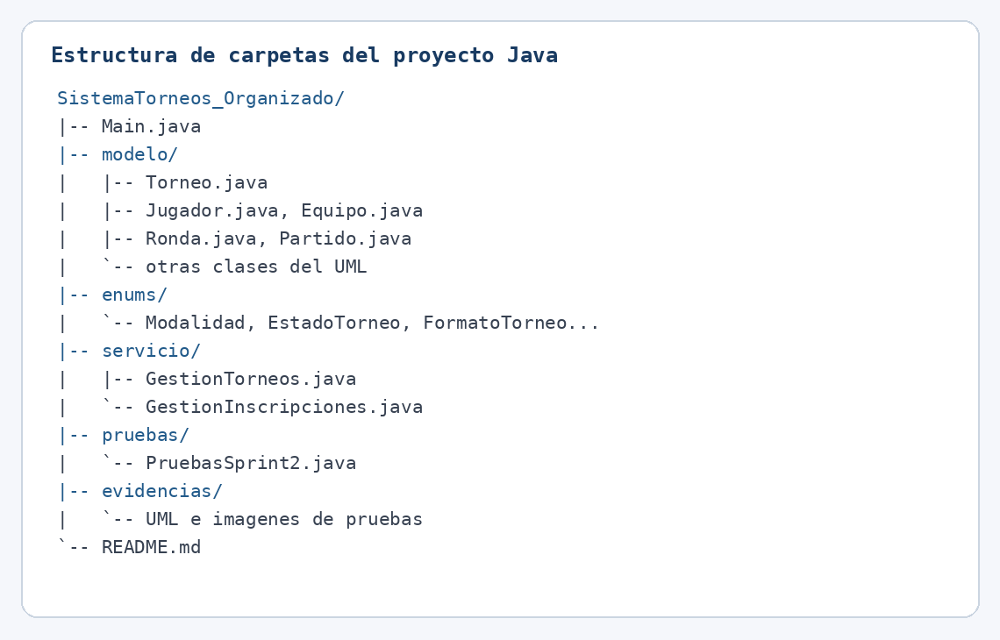

# Sistema de Gestión de Torneos de Videojuegos

Proyecto académico de **Programación Orientada a Objetos (Java)** basado en un diagrama UML. Permite simular desde consola torneos de videojuegos, registrar jugadores, programar partidas y obtener resultados.

## Datos generales

| Dato | Información |
| --- | --- |
| Universidad | Universidad Nacional de San Agustín de Arequipa (UNSA) |
| Curso | Desarrollo de Software Orientado a Objetos |
| Integrante | Tony Sergio Palomino Frisancho |
| Participación | Líder y único integrante |
| Lenguaje | Java 17 o superior |
| Interfaz actual | Consola |

## Funciones disponibles

- Crear torneos asociados a un videojuego.
- Inscribir y confirmar participantes; detectar inscripciones duplicadas.
- Organizar partidas de **eliminación directa**.
- Registrar marcadores, clasificar ganadores y determinar al campeón.
- Consultar la clasificación.
- Ejecutar pruebas adicionales con cuatro jugadores, semifinales y final.

## Estructura del proyecto

```text
SistemaTorneos_Organizado/
├── Main.java                      # Ejemplo de ejecución
├── modelo/                        # Clases del UML y validaciones
│   ├── Torneo.java
│   ├── Jugador.java
│   ├── Equipo.java
│   ├── Inscripcion.java
│   ├── Ronda.java
│   ├── Partido.java
│   └── ...
├── enums/                         # Enumeraciones (estados, tipos, formatos)
│   ├── Modalidad.java
│   ├── FormatoTorneo.java
│   └── ...
├── servicio/                      # Operaciones que usan las clases del modelo
│   ├── GestionTorneos.java
│   └── GestionInscripciones.java
├── pruebas/                       # Comprobaciones por consola
│   └── PruebasSprint2.java
├── evidencias/                     # Imágenes del informe
│   ├── diagrama_uml.png
│   ├── pruebas_sprint2.png
│   └── estructura_proyecto.png
└── README.md
```

Las carpetas `modelo`, `enums`, `servicio` y `pruebas` son **paquetes Java**. No se utiliza Maven; por eso **no hay `pom.xml`**. La clase `Main` está en la carpeta principal.

## Requisitos

- **JDK 17 o superior** (no basta con instalar solo JRE).
- Una terminal (PowerShell, Símbolo del sistema, Linux/macOS), o un editor compatible con Java.

Puedes comprobar la instalación con `java -version` y `javac -version`.

## Cómo compilar y ejecutar

Abre una terminal **dentro de `SistemaTorneos_Organizado`** y escribe:

```bash
javac -encoding UTF-8 -d . Main.java modelo/*.java enums/*.java servicio/*.java pruebas/*.java
java Main
```

Para ejecutar las pruebas del Sprint 2:

```bash
java pruebas.PruebasSprint2
```

> En **PowerShell** o CMD (Windows), puede usarse esta variante para compilar:
>
> ```powershell
> javac -encoding UTF-8 -d . Main.java modelo\*.java enums\*.java servicio\*.java pruebas\*.java
> ```
> Los `.class` generados no se incluyen en GitHub porque se vuelven a crear al compilar.

### Qué debería verse

- En `java Main`: creación de la Copa Universitaria, ganador **Ana** y clasificación.
- En `java pruebas.PruebasSprint2`: **7 verificaciones correctas**, con semifinales, final y controles de errores.

## Clases más importantes

| Clase | Responsabilidad |
| --- | --- |
| `Torneo` | Controla participantes, rondas y estado del torneo. |
| `Participante` | Clase abstracta base de `Jugador` y `Equipo`. |
| `Inscripcion` | Registra y confirma participantes. |
| `Ronda` y `Partido` | Organizan los encuentros. |
| `Resultado` | Representa el marcador. |
| `Clasificacion` | Resume los resultados. |
| `GestionTorneos` | Usa las operaciones del administrador para crear o cancelar torneos. |
| `GestionInscripciones` | Agrupa operaciones de registro y confirmación. |

## Avances del proyecto

- **Sprint 1:** clases principales a partir del UML y torneo básico.
- **Sprint 2:** torneo de cuatro jugadores, semifinales, final y siete comprobaciones.
- **Organización posterior al Sprint 2:** clases separadas en paquetes; mismas funciones y nuevas clases de servicio para facilitar futuras mejoras.

## Aspectos pendientes

- Menú interactivo para operar sin modificar el código.
- Guardar participantes, resultados y torneos de manera permanente.
- Interfaz gráfica.
- Calendario completo de doble eliminación (todavía no implementado).
- Autenticación segura: el ejemplo de administrador no debe tomarse como sistema de acceso real.

## Evidencias







## Autor

**Tony Sergio Palomino Frisancho** — primer año, segundo semestre.
